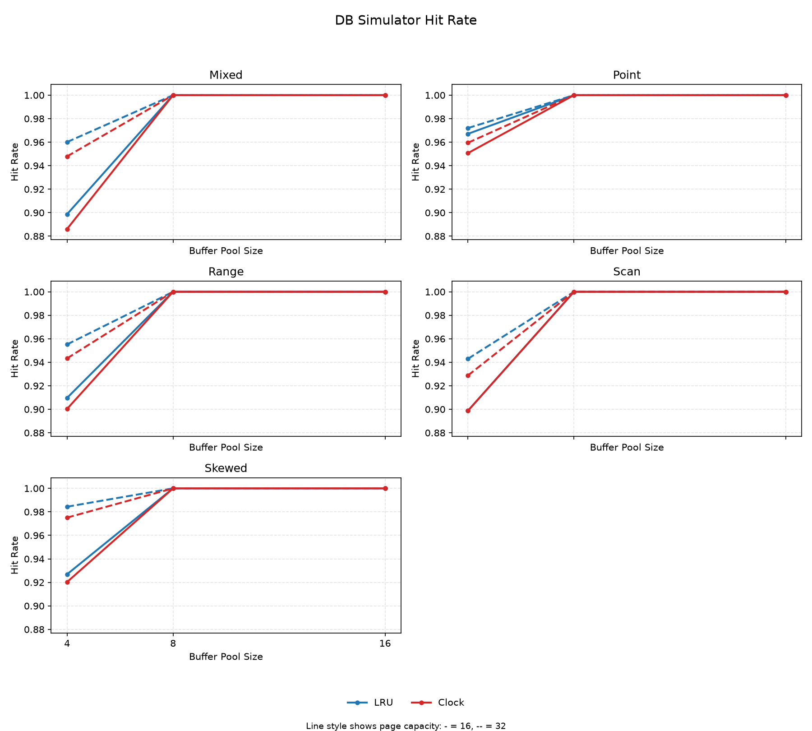
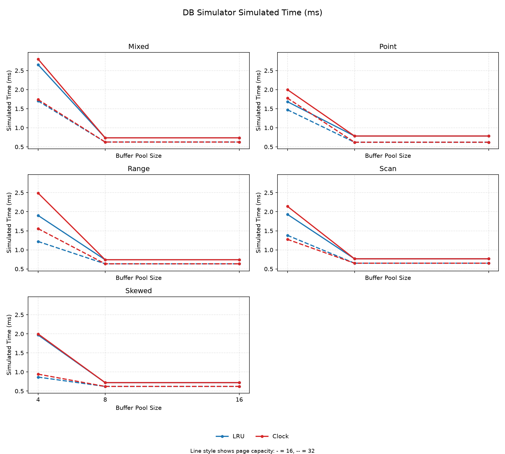
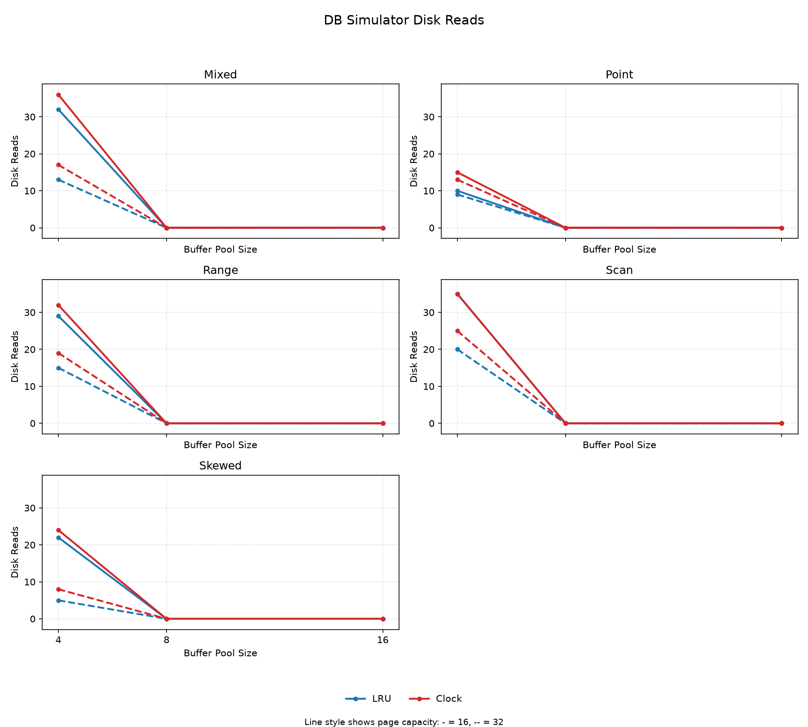
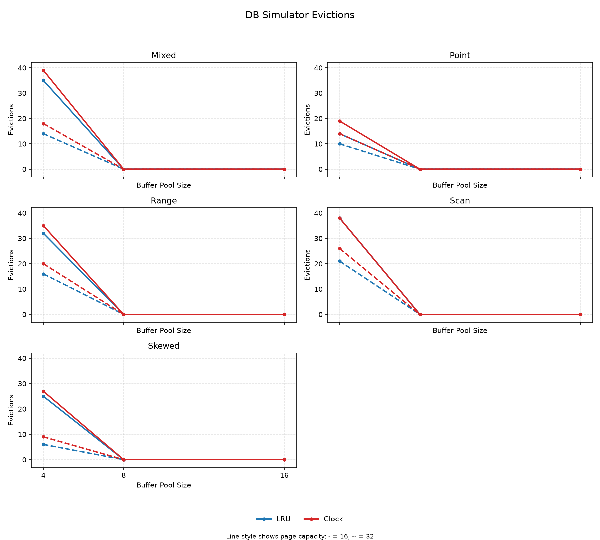

# DBMS Storage Engine Simulator

A simplified database storage-engine simulation in **Python** for exploring how indexing, buffer management, page replacement, and workload characteristics affect database performance.

The system integrates a disk-backed page model, a fixed-size buffer pool, and a B+ tree index. It supports both **LRU** and **Clock** replacement policies and includes automated workloads, tests, benchmark results, and performance visualizations.

This was an individual Database Concepts project. The course supplied the surrounding simulation and benchmarking infrastructure; my implementation focused on the **buffer pool manager, replacement policies, and B+ tree logic**.

## Highlights

- Disk-backed fixed-size page storage
- Configurable buffer pool with page pinning and dirty-page handling
- LRU replacement policy
- Clock / second-chance replacement policy
- B+ tree insertion, lookup, splitting, and range search
- Linked leaf nodes for sequential range traversal
- Point, range, scan, skewed, and mixed workloads
- Simulated disk-access costs
- 60 benchmark configurations across policies, buffer sizes, page capacities, and workloads
- Automated test suite: **12 tests passing**

## Architecture

```text
Workload Generator
        ↓
    B+ Tree Index
        ↓
Buffer Pool Manager
        ↓
    Disk Manager
        ↓
  Simulated Disk
```

The B+ tree determines which pages are required for a query. The buffer pool decides whether those pages can be served from memory or must be retrieved through the simulated disk manager, allowing the benchmark to measure how indexing, caching, replacement policy, and storage costs interact.

## My Implementation

### Buffer Pool Manager

`src/buffer_pool_manager.py` manages a fixed number of in-memory page frames and maps disk page IDs to frame IDs.

Implemented behavior includes:

- Page fetching and allocation
- Cache hit/miss tracking
- Pin and unpin management
- Dirty-page tracking
- Eviction when the pool is full
- Dirty-page flushing before reuse
- Page deletion
- Integration with the configured replacement policy
- Buffer statistics

Only unpinned pages are eligible for eviction.

### LRU Replacement

`src/replacement.py` implements a least-recently-used policy using an ordered collection of evictable frames. Accessed frames are moved toward the most-recent end, while eviction selects the least recently used eligible frame.

### Clock Replacement

The same module implements a Clock / second-chance policy using:

- A circular clock hand
- Per-frame reference bits
- Evictable-frame state

Recently referenced frames receive a second chance before becoming eviction candidates.

### B+ Tree

`src/bplustree.py` implements a disk-backed B+ tree with:

- Sorted insertion
- Exact-key lookup
- Range search
- Leaf splitting
- Internal-node splitting
- Root splitting
- Separator-key promotion
- Linked leaf nodes

Tree nodes are serialized into disk pages, so B+ tree operations interact with the buffer manager rather than existing only as in-memory Python objects.

## Example Data Flow

### Point Lookup

```text
Query key
   ↓
B+ tree traversal
   ↓
Target page ID
   ↓
Buffer pool lookup
   ├── Hit  → use cached page
   └── Miss → read page from simulated disk
```

### Buffer Eviction

```text
Page requested
      ↓
Free frame available?
   ┌───────┴───────┐
  Yes              No
   ↓                ↓
Use frame      Choose victim
                   ↓
             Dirty victim?
              ┌────┴────┐
             Yes        No
              ↓          ↓
          Write back   Reuse
              └────┬─────┘
                   ↓
              Load page
```

## Workloads

The benchmark exercises five access patterns:

- **Point** — individual key lookups
- **Range** — searches across key intervals
- **Scan** — sequential traversal
- **Skewed** — repeated access to a smaller set of hot keys
- **Mixed** — a combination of query types

A fixed random seed makes benchmark comparisons reproducible.

## Benchmark Configuration

| Parameter | Values |
| --- | --- |
| Replacement policy | LRU, Clock |
| Buffer pool size | 4, 8, 16 frames |
| Page capacity | 16, 32 records |
| Workload | Point, Range, Scan, Skewed, Mixed |
| Operations | 50 per workload |
| Random seed | 0 |

The full benchmark produces **60 configurations**.

## Results

Across the included benchmark, buffer-pool capacity had a larger effect than the choice between LRU and Clock.

| Policy | Pool Size | Avg. Hit Rate | Avg. Disk Reads | Avg. Evictions | Avg. Simulated Time |
| --- | ---: | ---: | ---: | ---: | ---: |
| Clock | 4 | 0.9311 | 22.4 | 24.5 | 1.8718 ms |
| LRU | 4 | 0.9416 | 19.0 | 21.1 | 1.6782 ms |
| Clock | 8 | 1.0000 | 0.0 | 0.0 | 0.6902 ms |
| LRU | 8 | 1.0000 | 0.0 | 0.0 | 0.6902 ms |
| Clock | 16 | 1.0000 | 0.0 | 0.0 | 0.6902 ms |
| LRU | 16 | 1.0000 | 0.0 | 0.0 | 0.6902 ms |

With only four buffer frames, LRU produced a slightly higher average hit rate and fewer disk reads and evictions than Clock. Once the benchmark's working set fit in the larger pools, both policies converged to the same measured performance.

## Benchmark Visualizations

### Cache Hit Rate



### Simulated Execution Time



### Disk Reads



### Evictions



## Project Structure

```text
dbms-storage-engine-simulator/
├── src/
│   ├── bplustree.py              # Student implementation
│   ├── buffer_pool_manager.py    # Student implementation
│   ├── replacement.py            # Student implementation
│   ├── dbsim/                    # Import compatibility layer
│   ├── benchmark.py              # Course-provided benchmark framework
│   ├── disk_manager.py           # Course-provided storage framework
│   ├── models.py                 # Course-provided data models
│   ├── plot_results.py           # Course-provided plotting utility
│   ├── simulator.py              # Course-provided simulation framework
│   └── workload.py               # Course-provided workload framework
├── tests/                        # Course-provided public test suite
├── results/
│   ├── benchmark_results.csv
│   └── plots/
├── requirements.txt
├── .gitignore
└── README.md
```

## Requirements

- Python 3.10+
- `pytest` for the automated test suite
- `matplotlib` for regenerating benchmark plots

Install the optional testing/plotting dependencies with:

```bash
python -m pip install -r requirements.txt
```

## Running the Project

Run the demo simulation:

```bash
python src/main.py
```

Run the test suite:

```bash
python -m pytest -q
```

Run the complete benchmark:

```bash
python src/benchmark.py
```

Regenerate the plots:

```bash
python src/plot_results.py results/benchmark_results.csv
```

## Project Provenance

This repository contains a course-provided starter framework that I completed as an individual project.

My implementation work was concentrated in:

- `src/buffer_pool_manager.py`
- `src/replacement.py`
- `src/bplustree.py`

The disk manager, base models, simulator, workload/benchmark framework, plotting utilities, compatibility wrappers, and public tests were supplied as supporting course infrastructure. They are retained here because the completed student components are designed to run as an integrated storage-engine simulation.
